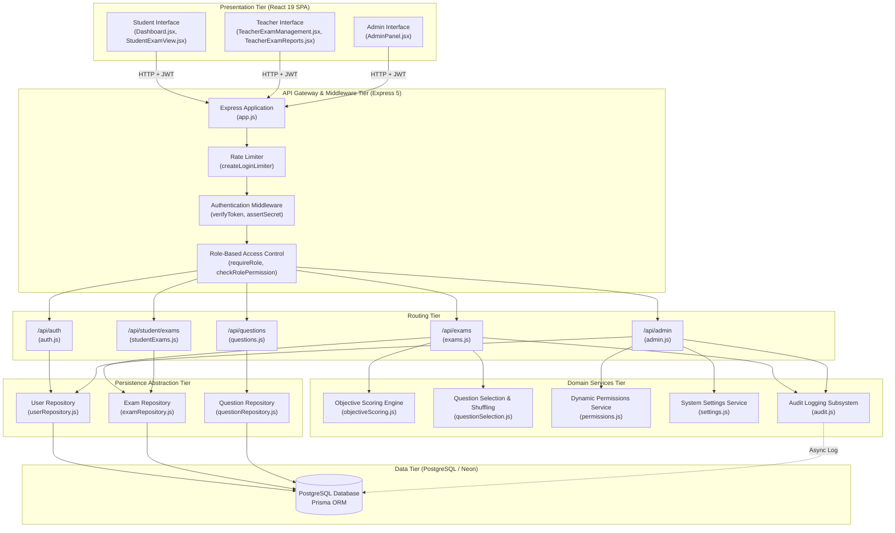
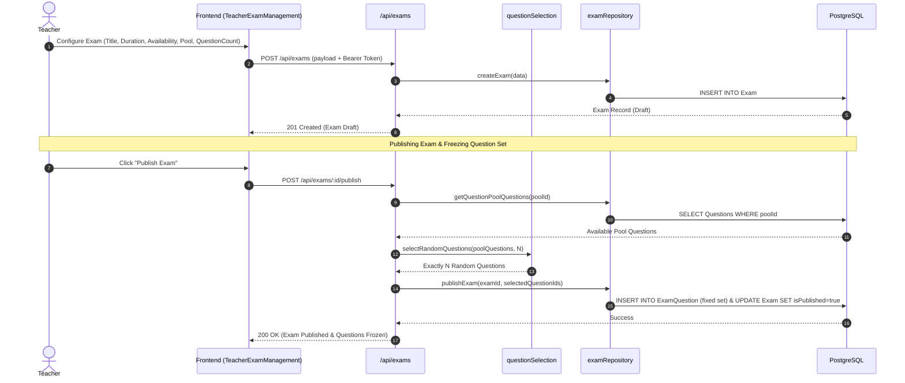
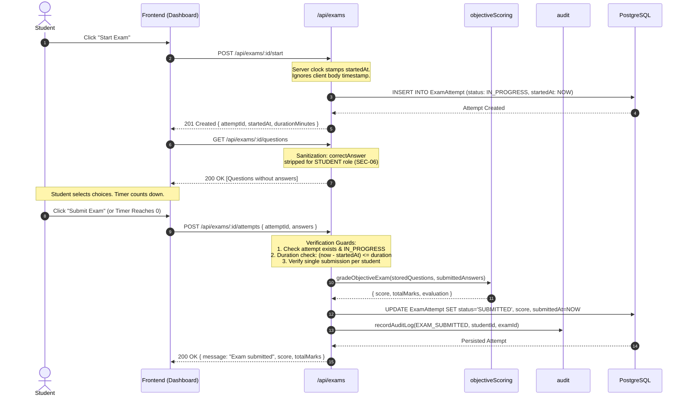
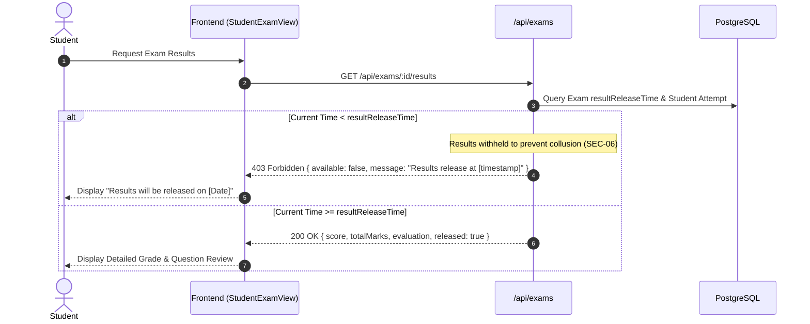
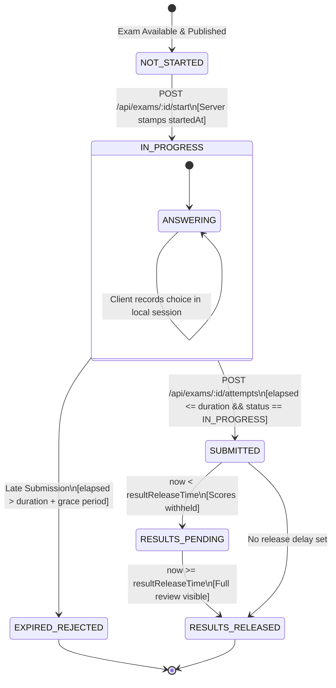
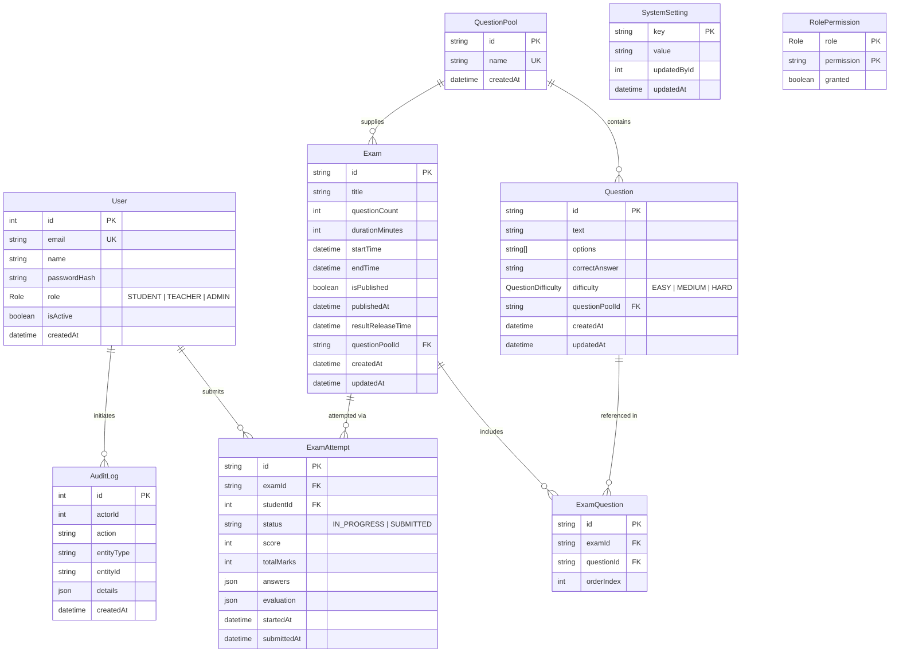

# Software Architecture Document (SAD)
## Online Examination Portal — As-Built Architecture (Phase 2)

**Author:** Manasvi Dr. (Team E6)  
**System:** Online Examination Portal  
**Document Version:** 2.0 (Phase 2 Final)  
**Status:** Approved & Implemented  
**Date:** November 2026  

---

## 1. Executive Summary & Purpose

This Software Architecture Document (SAD) captures the comprehensive architectural design of the **Online Examination Portal** as implemented in Phase 2. The system is an enterprise-grade, secure, web-based examination platform supporting three distinct user roles: **Students (Candidates)**, **Teachers (Instructors)**, and **Administrators**.

The platform provides end-to-end management of the examination lifecycle:
1. **Curriculum & Question Bank Management**: Creating question pools and authoring objective Multiple Choice Questions (MCQs) with difficulty tiers.
2. **Deterministic & Fair Exam Authoring**: Configuring exam duration and availability windows, and automatically selecting fixed question sets upon publishing.
3. **Robust Exam Execution**: Enforcing duration via server-authoritative timestamps, handling answer persistence, and blocking late submissions.
4. **Secure Evaluation & Scheduled Release**: Server-side automated grading with anti-cheating protections and scheduled result publication.
5. **Administrative Oversight & Compliance**: System configuration, dynamic role permissions, and immutable audit logging.

This document updates the preliminary Phase 1 design to reflect the **as-built system**, detailing architectural patterns, component decompositions, data models, state machines, and security controls.

---

## 2. Architectural Principles & Styles

The Online Examination Portal is structured around the following architectural principles:

```
+---------------------------------------------------------------------------------------+
|                                Presentation Layer                                     |
|                   React 19 Single Page Application (Vite Bundler)                     |
+---------------------------------------------------------------------------------------+
                                          |
                                          | HTTPS / REST (JSON) + JWT Bearer
                                          v
+---------------------------------------------------------------------------------------+
|                               API & Routing Layer                                     |
|                      Express 5 Router with Dependency Injection                       |
+---------------------------------------------------------------------------------------+
           |                                  |                             |
           v                                  v                             v
+--------------------+              +--------------------+        +--------------------+
|     Middleware     |              |  Domain Services   |        |  Audit Subsystem   |
| - JWT Auth         |              | - Scoring Engine   |        | - Async Logging    |
| - RBAC Guard       |              | - Random Selection |        | - Non-blocking     |
| - Rate Limiter     |              | - Permissions      |        | - Tamper-resistant |
+--------------------+              +--------------------+        +--------------------+
           \                                  /                             /
            \                                /                             /
             v                              v                             v
+---------------------------------------------------------------------------------------+
|                         Persistence Abstraction Layer                                 |
|                       Repository Pattern (Data Gateways)                              |
|           [UserRepository]     [ExamRepository]     [QuestionRepository]              |
+---------------------------------------------------------------------------------------+
                                          |
                                          | Prisma ORM 7 Engine
                                          v
+---------------------------------------------------------------------------------------+
|                                 Database Layer                                        |
|                          PostgreSQL / Neon Serverless                                 |
+---------------------------------------------------------------------------------------+
```

### 2.1 Layered Modular Architecture
- **Presentation Layer**: Built with React 19, delivering responsive, role-specific views (`LoginPage`, `Dashboard`, `TeacherExamManagement`, `TeacherExamReports`, `StudentExamView`, `AdminPanel`).
- **API & Routing Layer**: Express 5 application delegating endpoints across isolated route handlers (`auth.js`, `exams.js`, `questions.js`, `studentExams.js`, `admin.js`).
- **Domain Services Layer**: Pure business logic separated from HTTP concerns (`objectiveScoring.js`, `questionSelection.js`, `permissions.js`, `settings.js`, `audit.js`).
- **Persistence Abstraction Layer**: Implements the Repository Pattern, completely decoupling database access from business routes.
- **Data Layer**: Relational schema managed by Prisma ORM backed by PostgreSQL (supporting serverless cloud deployments such as Neon).

### 2.2 Dependency Injection for Testability
Every router is a factory function accepting injected dependencies (e.g., `createExamRouter({ examRepo, auditRepo })`, `createApp({ userRepo, jwtSecret })`). This architectural choice enables:
- **Instant Unit and Integration Testing**: Complete suite executes in $< 11$ seconds against fast in-memory repositories without spinning up external containers or databases.
- **Zero Test Collisions**: Independent in-memory state per test case prevents flaky tests and race conditions.
- **Polymorphic Storage**: Swappable persistence backends (in-memory test fakes vs. production Prisma repositories) without altering route handlers.

### 2.3 Server-Authoritative Security Boundary
The client browser is strictly treated as an untrusted presentation layer:
- **Zero Client Grading**: The server independently grades submissions against stored answer keys.
- **Server Clock Duration Enforcement**: Attempt start times and completion times are stamped by the server clock, preventing client-side timer manipulation.
- **Answer Sanitization**: Correct answers are scrubbed from student-facing API responses (`SEC-06`).
- **Non-Repudiation**: Administrative and student lifecycle operations trigger audit log records (NFR-12).

---

## 3. High-Level Architecture Diagram

The diagram below illustrates the end-to-end system topology, component interactions, and data flows across all three user roles:



---

## 4. Component & Module Breakdown

### 4.1 Server Module Hierarchy (`server/src`)

| Module Path | Primary Responsibility | Interface / Key Exports |
|---|---|---|
| `app.js` | Express app assembly, router mounting, global error handler | `createApp({ userRepo, examRepo, questionRepo, jwtSecret, limiter, corsOrigin })` |
| `index.js` | Production entry point, environment loading, database initialization | Initializes Prisma, starts HTTP listener on `PORT` |
| `db.js` | Prisma Client singleton and connection lifecycle | `getPrisma()` |
| `auth/tokens.js` | Cryptographic JWT signing, verification, secret validation | `signToken(user, opts)`, `verifyToken(token, opts)`, `assertSecret(secret)` |
| `auth/rateLimiter.js` | Memory-based rate limiter guarding brute-force logins | `createLoginLimiter({ windowMs, maxAttempts })` |
| `middleware/auth.js` | JWT extraction, verification, role enforcement guards | `authenticate({ secret })`, `requireRole(...roles)` |
| `routes/auth.js` | Login endpoints (`/api/auth/login/:portal`) and profile verification (`/api/auth/me`) | `createAuthRouter({ userRepo, secret, expiresIn, limiter })` |
| `routes/exams.js` | Exam creation, updating, publishing, reports, student attempt lifecycle | `createExamRouter({ examRepo, auditRepo })` |
| `routes/questions.js` | Question pool creation and objective question management | `createQuestionRouter({ questionRepo, examRepo })` |
| `routes/studentExams.js`| Available exam discovery for students | `createStudentExamRouter({ examRepo })` |
| `routes/admin.js` | User provisioning, role switching, system settings, role permissions, audit query | `createAdminRouter({ userRepo, settingsRepo, permissionsRepo, auditRepo })` |
| `services/objectiveScoring.js` | Deterministic MCQ scoring, option-index normalization, evaluation breakdown | `gradeObjectiveExam({ questions, answers })` |
| `services/questionSelection.js` | Uniform sampling without replacement and attempt order shuffling | `selectRandomQuestions(pool, count)`, `shuffleQuestions(questions)` |
| `services/permissions.js` | Role permission matrix and dynamic overrides | `canRolePerform(role, permission)`, `getEffectivePermissions()` |
| `services/settings.js` | Whitelisted system configuration management | `getSettings()`, `updateSetting(key, val, actorId)` |
| `services/audit.js` | Fire-and-forget resilient audit event recorder | `recordAuditLog({ actorId, action, entityType, entityId, details })` |
| `repositories/examRepository.js` | Prisma-backed data gateway for exams, questions, attempts, and reports | `createPrismaExamRepository(prisma)` |
| `repositories/questionRepository.js`| Prisma-backed gateway for question pools and questions | `createPrismaQuestionRepository(prisma)` |
| `repositories/userRepository.js` | Prisma-backed gateway for user accounts and credentials | `createPrismaUserRepository(prisma)` |

### 4.2 Client Module Hierarchy (`client/src`)

| Component / Module | Responsibility |
|---|---|
| `App.jsx` | Top-level state container; determines view based on auth token and user role |
| `LoginPage.jsx` | Role tabs (Student, Teacher, Admin), input validation, login API dispatcher |
| `Dashboard.jsx` | Student examination portal shell: lists available exams, manages timer, coordinates question navigation and submit modal |
| `TeacherExamManagement.jsx` | Exam creation wizard, pool selector, duration/availability timing controls, and publish action |
| `TeacherExamReports.jsx` | Exam performance metrics: average score, pass rates, score distribution, and student attempt lists |
| `StudentExamView.jsx` | Review interface for completed exams and released grades |
| `AdminPanel.jsx` | User management table, role privilege toggles, system settings editor, and audit log viewer |
| `api.js` | Typed HTTP client wrapping `fetch` with token injection and unified error handling |
| `auth.js` | Session storage abstraction (`localStorage`/`sessionStorage`), token lifecycle management |

---

## 5. Detailed System Workflows & Sequence Diagrams

### 5.1 Exam Creation, Random Selection & Publishing Flow (FR-07, FR-08, FR-09, FR-10)



### 5.2 Student Attempt Lifecycle & Duration Enforcement (FR-12, FR-13, FR-14, FR-15, FR-17, FR-18)



### 5.3 Scheduled Result Release Flow (FR-19, SEC-06)



---

## 6. Attempt Lifecycle State Machine

The attempt state machine governs candidate progression from initiation through final grading:



---

## 7. Data Architecture & Entity Relationships

The data model is defined in Prisma schema (`server/prisma/schema.prisma`) and backed by PostgreSQL:



### 7.1 Relational Integrity Rules
1. **Cascade & Restrict Policies**:
   - `Exam` to `QuestionPool`: `onDelete: Restrict` prevents accidental deletion of question pools referenced by existing exams.
   - `ExamQuestion` to `Exam`: `onDelete: Cascade` ensures question links are cleaned up if a draft exam is deleted.
   - `ExamQuestion` to `Question`: `onDelete: Restrict` protects questions referenced in active exams from deletion (`VAL-F13`).
   - `ExamAttempt` to `Exam` & `User`: `onDelete: Restrict` guarantees immutable historical records for audits and grading.
2. **Indexing Strategy**:
   - `AuditLog`: Composite indexes on `[createdAt]` and `[actorId]` optimize admin query filtering.
   - `ExamAttempt`: Composite index on `[examId, studentId]` enables O(1) duplicate submission checks and attempt retrieval.
   - `Question`: Composite index on `[questionPoolId, createdAt]` accelerates pool queries and random selection.

---

## 8. Security & Access Control Architecture

### 8.1 Authentication & Token Architecture
- **Cryptographic Signature**: JSON Web Tokens (JWT) signed via HMAC-SHA256 (`HS256`).
- **Enforced Entropy**: System strictly refuses to initialize with secrets shorter than 32 characters (`assertSecret`).
- **Token Claims**: Contains authenticated `userId`, `email`, and `role`. Tokens expire after a configurable duration (default: `24h` / `1h`).
- **Session Rate Limiting**: Repeated failed login attempts are throttled per IP/email using `createLoginLimiter` to mitigate brute-force attacks.

### 8.2 Role-Based Access Control (RBAC) Matrix

| Endpoint Group | Resource / Action | STUDENT | TEACHER | ADMIN | Enforcement Mechanism |
|---|---|:---:|:---:|:---:|---|
| `/api/auth/*` | Login & Profile Me | Allowed | Allowed | Allowed | `authenticate` |
| `/api/student/exams` | View Available Exams | **Allowed** | Denied (403) | Denied (403) | `requireRole('STUDENT')` |
| `/api/exams/:id/start` | Start Attempt | **Allowed** | Denied (403) | Denied (403) | `requireRole('STUDENT')` |
| `/api/exams/:id/attempts` | Submit Exam Attempt | **Allowed** | Denied (403) | Denied (403) | `requireRole('STUDENT')` |
| `/api/exams/:id/results` | View Released Results | **Allowed** | Allowed | Allowed | Gated by `resultReleaseTime` |
| `/api/exams` | Create Draft Exam | Denied (403) | **Allowed** | **Allowed** | `requireRole('TEACHER', 'ADMIN')` |
| `/api/exams/:id/publish` | Publish Exam & Freeze | Denied (403) | **Allowed** | **Allowed** | `requireRole('TEACHER', 'ADMIN')` |
| `/api/exams/:id/report` | View Aggregate Reports | Denied (403) | **Allowed** | **Allowed** | `requireRole('TEACHER', 'ADMIN')` |
| `/api/questions/*` | Create/Edit Questions | Denied (403) | **Allowed** | **Allowed** | `requireRole('TEACHER', 'ADMIN')` |
| `/api/admin/*` | User & Settings Mgmt | Denied (403) | Denied (403) | **Allowed** | `requireRole('ADMIN')` |

### 8.3 Anti-Cheating & Integrity Protections
1. **Information Leakage Prevention (SEC-06)**: Question fetching endpoints dynamically inspect the requester's role. For `STUDENT` requests, `correctAnswer` is omitted from JSON payloads.
2. **Server-Side Scoring**: Submissions pass only the student's selected choices (`{ questionId: selectedOption }`). The score is computed server-side by iterating over the stored question keys. Any client-submitted score is discarded.
3. **Identity Derivation**: `studentId` is strictly extracted from `req.auth.userId`. Body spoofing attacks (e.g. attempting to submit as another user ID) are neutralized.
4. **Duration Enforcement**: The server records `startedAt` during `/start` and rejects submissions where `(currentTime - startedAt) > durationMinutes * 60 * 1000 + gracePeriod`.
5. **Single-Submission Lock**: Exactly one attempt per student per exam is permitted; duplicate submissions return HTTP 409 Conflict.

---

## 9. Non-Functional Quality Attribute Verification

| NFR Identifier | Description | Target SLA | Verified As-Built Capability | Verification Reference |
|---|---|---|---|---|
| **NFR-01** | UI Usability & Simplicity | Clean portal tabs | Tabbed login, clear status badges, intuitive timer | `client/src/Dashboard.jsx` |
| **NFR-02** | Data Persistence Across Restarts | Zero data loss | PostgreSQL ACID durability verified | `server/test/sprint2_manasvi.test.js` |
| **NFR-03** | API Latency & Performance | $\le 3\text{ seconds}$ under normal load | Average response $< 10\text{ ms}$; all routes respond in $< 60\text{ ms}$ | `server/test/nfr03_performance.test.js` |
| **NFR-04** | High System Availability | Continuous uptime during exam windows | 100% successful health and question pings across simulated exam window | `server/test/nfr04_availability.test.js` |
| **NFR-07** | Modular Decoupling | Clean separation of concerns | Repositories swappable; DI across all routes | `docs/architecture-modules.md` |
| **NFR-10** | Scalability & Concurrency | 50 concurrent students | 50 parallel requests handled with 0% error rate | `server/test/nfr10_scalability.test.js` |
| **NFR-11** | Relational Data Integrity | Foreign key consistency | Prisma foreign keys with Restrict/Cascade rules | `server/test/sprint2_manasvi.test.js` |
| **NFR-12** | Audit Trail Compliance | Immutable administrative logging | Non-blocking async audit logging for all critical operations | `server/test/admin.test.js` |
| **B-15** | Comprehensive Security Validation | Zero unauthorized escalations | 100% passing automated penetration and boundary suite | `server/test/b15_security.test.js` |

---

## 10. Architectural Evolution & Deviations Summary

As documented in `docs/deviations-note.md`, the architecture evolved from the preliminary Phase 1 draft to the robust Phase 2 as-built release:
1. **Focus on Deterministic Objective MCQs**: Prioritized objective grading to ensure mathematically certain, instant automated grading and elimination of subjective scoring latency.
2. **Deterministic Random Sampling**: Replaced on-the-fly random questions with a two-phase selection: uniform random sampling at publish time, creating an identical fixed `ExamQuestion` set for all candidates.
3. **Strict State Machine & Timing Enforcement**: Transitioned from client-driven timers to a server-authoritative attempt state machine (`IN_PROGRESS` $\to$ `SUBMITTED`) using server clock timestamps.
4. **Enterprise Administration & Dynamic RBAC**: Incorporated administrative settings, dynamic role permission overrides, and comprehensive audit logging.
